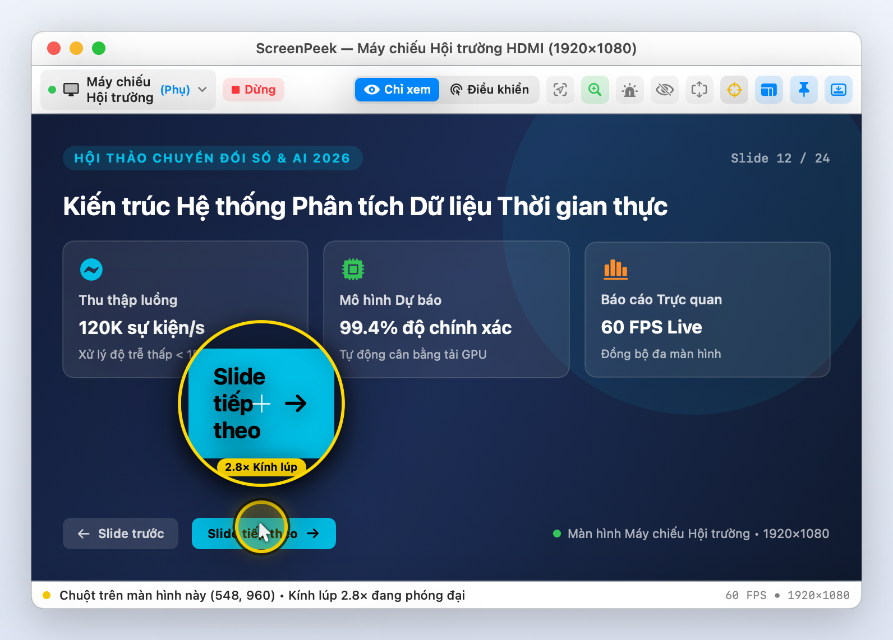
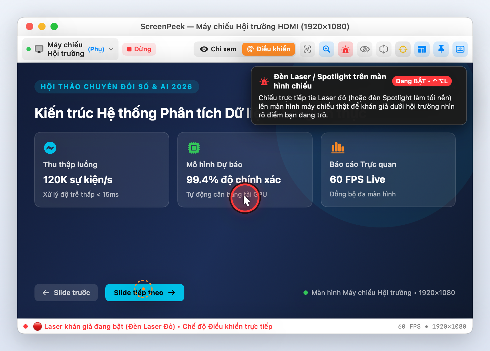
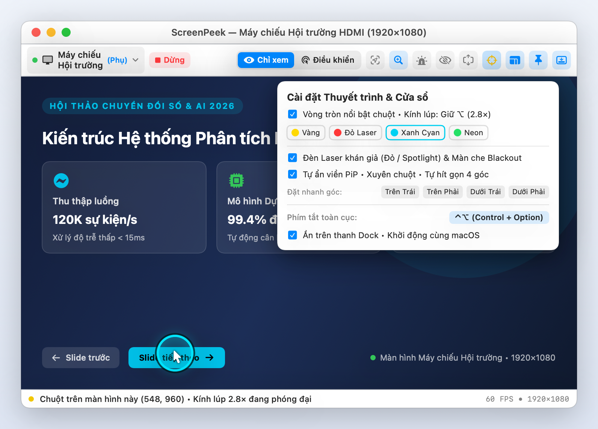

# ScreenPeek 🖥️🔍

**ScreenPeek** là ứng dụng macOS gọn nhẹ (viết bằng Swift + `ScreenCaptureKit`) hiển thị trực tiếp nội dung của **màn hình kết nối (External Display / Máy chiếu)** trong một cửa sổ nổi có thể co dãn ngay trên màn hình máy tính chính.

Ứng dụng được thiết kế chuyên biệt cho bối cảnh **thuyết trình, hội thảo, giảng dạy**: khi bạn đứng song song hoặc quay lưng với màn hình máy chiếu lớn ở chế độ *Extended Display*, bạn không cần phải ngoái cổ nhìn màn hình phụ mà vẫn quan sát rõ chữ nhỏ, vị trí chuột, chiếu đèn Laser cho khán giả và điều khiển mượt mà ngay trên màn hình laptop.

---

## 📸 Hình ảnh giao diện

### 1. Chế độ Chỉ xem (`Live View`), Vòng sáng con trỏ & Kính lúp phóng đại (`Zoom Loupe`)


### 2. Chế độ Điều khiển trực tiếp (`Interactive`), Đèn Laser & Ghi chú tính năng tức thì (`Instant Tooltip`)


### 3. Bảng Cài đặt nâng cao (Laser khán giả, Màn che bảo mật, Hít 4 góc, Phím tắt & Ẩn thanh Dock)


---

## ✨ Tính năng nổi bật (v1.1.0)

1. **Truyền hình trực tiếp 60 FPS & Tối ưu pin động (`Dynamic Stream Scaling`)**:
   - Kết xuất trực tiếp qua `IOSurface` (zero-copy GPU). Tự động co dãn độ phân giải thu hình theo kích thước cửa sổ thực tế và tự dừng bộ đếm nền khi ẩn/dừng cửa sổ để tiết kiệm tối đa pin MacBook.
   - Tự động loại trừ tất cả cửa sổ của `ScreenPeek` để không bao giờ bị lặp hình vô tận (*infinite mirror*).
2. **Kính lúp phóng đại vùng quanh chuột (`Cursor Zoom Loupe`)**:
   - Phóng đại sắc nét `1.8x – 4.5x` vùng chữ và nút bấm ngay dưới mũi chuột (chế độ *Giữ phím `⌥ Option`* hoặc *Luôn bật*), giúp đọc rõ các nút nhỏ trên màn hình `1080p`/`4K` ngay cả khi thu nhỏ cửa sổ.
3. **Đèn Laser & Spotlight thật trên màn hình máy chiếu (`Audience Laser Pointer`)**:
   - Chiếu tia **Laser Đỏ** hoặc **Spotlight sân khấu (làm tối nền xung quanh)** trực tiếp lên màn hình máy chiếu thật giúp khán giả dưới hội trường nhìn rõ điểm bạn đang chỉ mà không cần bút laser vật lý.
4. **Màn che bảo mật màn hình phụ (`Privacy Blackout Shield`)**:
   - Phủ màn hình chờ lịch sự lên máy chiếu với khán giả (*"Đang chuẩn bị nội dung tiếp theo..."*), trong khi bạn **vẫn nhìn thấy và thao tác riêng tư bình thường** với các cửa sổ bên dưới ngay từ trong `ScreenPeek`!
5. **2 chế độ tương tác chuột linh hoạt**:
   - **👁 Chỉ xem (`Live View`)**: Di chuột thật sang màn hình phụ và quan sát qua cửa sổ nhỏ. Nhấp đúp vào hình để nhảy nhanh chuột sang vị trí đó.
   - **🖱 Điều khiển trực tiếp (`Interactive`)**: Click trái/phải, nhấp đúp, kéo thả hoặc cuộn trang ngay trong cửa sổ nhỏ (tự giữ chuột ở lại cửa sổ nhỏ sau khi click).
6. **Tiện ích cửa sổ Picture-in-Picture chuyên nghiệp**:
   - **Tự ẩn thanh công cụ (`Borderless PiP Mode`)**: Tràn viền 100% khi chuột rời khỏi cửa sổ, tự hiện lại khi rê chuột vào.
   - **Chế độ Xuyên chuột (`Click-Through Ghost Mode`)**: Click xuyên qua cửa sổ `ScreenPeek` xuống ứng dụng bên dưới trên laptop (giữ `⌥⌘` để tạm nắm kéo cửa sổ).
   - **Tự hít 4 góc màn hình (`Magnetic Corner Snap`)**, **Khóa tỷ lệ khung hình**, **Ghim luôn nổi (`Always on Top`)**, **Ẩn khỏi thanh Dock** và **Tự khởi động cùng macOS (`Launch at Login`)**.

---

## ⌨️ Phím tắt toàn cục (Global Hotkeys — Có thể tuỳ chỉnh bộ phím `⌃⌥` / `⌃⇧` / `⌘⇧`)

Mặc định sử dụng bộ phím **`⌃⌥` (`Control + Option`)** để không xung đột với phím tắt `⌘⇧C` (Inspect Element) của trình duyệt:

| Phím tắt mặc định | Chức năng |
| :--- | :--- |
| `⌃⌥M` | Hiện / Ẩn nhanh cửa sổ **ScreenPeek** |
| `⌃⌥C` | **Chuyển nhanh chuột qua lại giữa 2 màn hình** (chính ↔ phụ) |
| `⌃⌥I` | Đổi nhanh giữa chế độ **Chỉ xem** và **Điều khiển trực tiếp** |
| `⌃⌥L` | Bật / Tắt **Đèn Laser / Spotlight** cho khán giả trên màn hình chiếu |
| `⌃⌥B` | Bật / Tắt **Màn che bảo mật (Blackout)** trên màn hình chiếu |
| `⌃⌥T` | Bật / Tắt **Chế độ Xuyên chuột (Click-Through)** |

---

## 📥 Cài đặt & Sử dụng

### Cách 1: Tải bản đóng gói sẵn (Releases)
1. Tải file **`ScreenPeek.zip`** tại mục [**Releases**](../../releases/latest).
2. Giải nén và kéo **`ScreenPeek.app`** vào thư mục `/Applications` (hoặc chạy trực tiếp).
3. Nếu macOS báo ứng dụng chưa xác thực Apple Developer ID, mở Terminal chạy lệnh gỡ cách ly:
   ```bash
   xattr -cr /Applications/ScreenPeek.app
   ```
4. Cấp quyền lần đầu trong **System Settings > Privacy & Security**:
   - **Screen & System Audio Recording (Ghi màn hình)**: Bắt buộc để hiển thị nội dung màn hình kết nối.
   - **Accessibility (Trợ năng)**: Tuỳ chọn — chỉ cần nếu bạn dùng chế độ *Điều khiển trực tiếp (`Interactive`)* để gửi thao tác click/cuộn chuột từ xa.

### Cách 2: Tự biên dịch từ mã nguồn (macOS 14.0+)
```bash
git clone https://github.com/hungmtuci/ScreenPeek.git
cd ScreenPeek
chmod +x build_screenpeek.sh
./build_screenpeek.sh
open ScreenPeek.app
```

---

## 🗂️ Cấu trúc dự án

```text
ScreenPeek/
├── Package.swift
├── build_screenpeek.sh
├── scripts/
│   └── generate_icon.swift                 # Tự động vẽ & đóng gói biểu tượng chuẩn macOS AppIcon.icns
└── Sources/ScreenPeek/
    ├── ScreenPeekApp.swift                 # AppDelegate, Menu Bar, Hotkeys, Snap 4 góc & PiP
    ├── Models/
    │   └── DisplayInfo.swift               # Model màn hình, Loupe, Laser, HotKey Preset & UI
    ├── Services/
    │   ├── ScreenCaptureManager.swift      # Thu hình ScreenCaptureKit + Dynamic Scaling tiết kiệm pin
    │   ├── CursorAndInputController.swift  # Theo dõi chuột thông minh & điều khiển từ xa CGEvent
    │   └── ProjectorOverlayManager.swift   # Cửa sổ Đèn Laser / Spotlight & Màn che Blackout máy chiếu
    └── UI/
        ├── PreviewWindowView.swift         # Thanh công cụ, Instant Tooltips & Cài đặt nâng cao
        └── VideoSurfaceView.swift          # Lớp hiển thị CALayer + Kính lúp GPU IOSurface
```

## 📄 Giấy phép

Phát hành theo giấy phép [MIT License](LICENSE).
